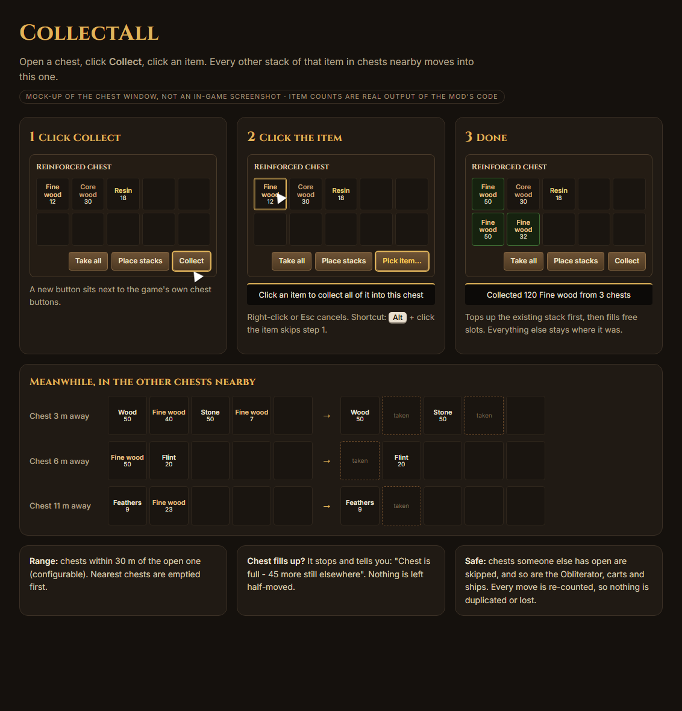

# CollectAll

A BepInEx mod for Valheim. Open a chest and Alt+click an item (or click **Collect**, then the item): every other stack of that item in chests nearby moves into the chest you have open.



*(Mock-up of the chest window; the item counts are real output of the mod's code. See [`docs/collectall.html`](../docs/collectall.html).)*

## Using it

1. Open the chest you want things gathered into.
2. Click **Collect** in the top-right corner of the chest panel, next to the chest's name. It changes to **Pick item...**
3. Click an item, in the chest or in your own inventory. All other stacks of that item (any quality) in chests within 60 m move into this chest. Smaller piles are taken first, and existing stacks are topped up before new slots are used.

**Full stashes are left alone** (on by default): a chest that is completely full and holds nothing but that item is never taken from, so collecting in a second chest can't drain a finished stash.

**Bigger pile wins** (off by default, `SkipBiggerPiles`): a chest that holds *more* of the item than the one you're collecting into is left alone. Items then only ever flow toward your biggest pile, so collecting in two chests in turn can't shuffle them back and forth.

Shortcut: **Alt + click** an item in the chest does it in one step. Change the key with `ShortcutKey`.

Right-click or Esc cancels pick mode. The message in the middle of the screen says what happened:

- `Collected 120 Fine wood from 3 chests`
- `Chest is full - 45 more still elsewhere`
- `No other Fine wood in chests within 60 m`
- `The only other Fine wood is in full Fine wood chests - left alone`
- `Other chests have more Fine wood than this one` (with `SkipBiggerPiles` on)
- `2 chests skipped (open, or another player's)`

Your own inventory is never touched; only other chests are emptied.

The button is pinned to the top-right corner of the chest panel, so it stays put whatever buttons the game or other mods (QuickStackStore etc.) add elsewhere. `Button.OffsetX` / `OffsetY` nudge it.

## What it won't touch

- Chests someone has open
- The Obliterator, carts, ships, tombstones
- Chests you don't have access to (other players' private chests, chests inside a ward you aren't on)
- In multiplayer: chests another player's game controls (always fine in single player; usually fine when you're alone in your base).

## Config

`BepInEx/config/dcarrigg.collectall.cfg` (r2modman: Config editor):

| Setting | Default | |
|---|---|---|
| `Radius` | 60 | How far from the open chest to look (m). The game only keeps about 64 m around you loaded |
| `AltClickShortcut` | on | Key + click collects straight away |
| `ShortcutKey` | LeftAlt | Key to hold for the shortcut, e.g. `LeftControl`, `LeftShift`, `Z`. Left/right Alt, Ctrl and Shift both count |
| `SkipFullChests` | on | Never take from a chest that's completely full and holds nothing but that item. One stray item, a partial stack or an empty slot and it's collected from as normal. Turn off to move a whole stash into a new chest |
| `SkipBiggerPiles` | off | Bigger pile wins (see above) |
| `Button.Text` | Collect | Button label |
| `Button.OffsetX` / `OffsetY` | 0 | Nudge the button if it overlaps another mod's button |

## Safety

Every move uses the game's own inventory code, through the same move-and-recount code as SignSorter (`Shared/InventoryOps.cs`). After each move, both chests are re-counted and any difference is repaired, so items are never duplicated or lost, even if another mod's save hook throws an error. Tests run the collect logic against the game's real `Inventory` class, including 3,000 random scenarios. They check that every item is accounted for and that nothing that would fit is left behind.

## Building

```
dotnet build CollectAll -c Release
```

Copy only `CollectAll/bin/Release/CollectAll.dll` into `BepInEx/plugins/`. Paths to Valheim and BepInEx are at the top of `CollectAll.csproj`. Tests live in `SignSorter.Tests` (the `collect:` tests); run `dotnet SignSorter.Tests/bin/Release/SignSorter.Tests.dll`, or `--collect-demo` for the example above.

## Not verified yet

Built and tested outside the game only. Things to check in game:

- That its label reads "Collect", not "Place stacks".
- That the shortcut key doesn't clash with another mod you use.
