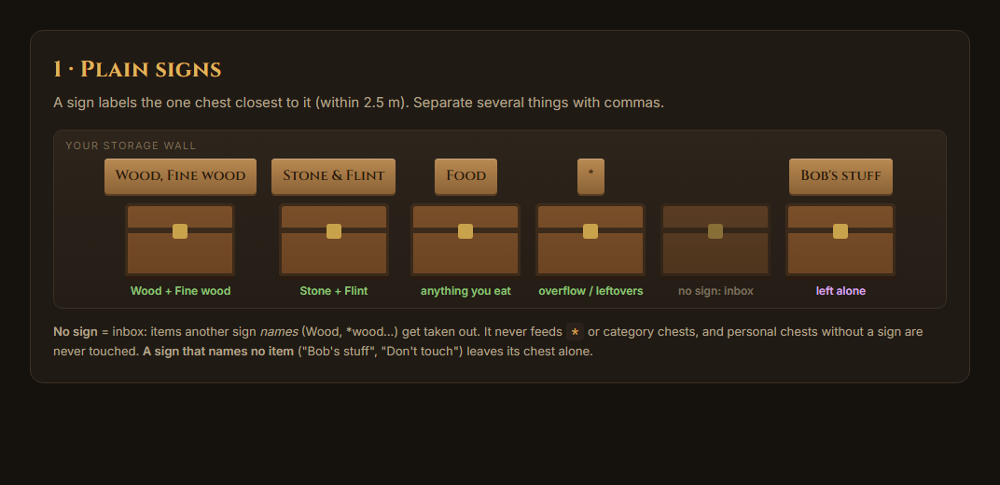
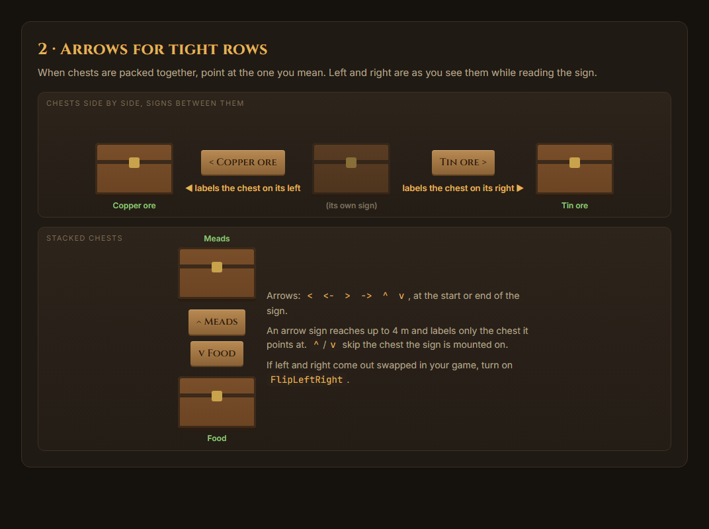
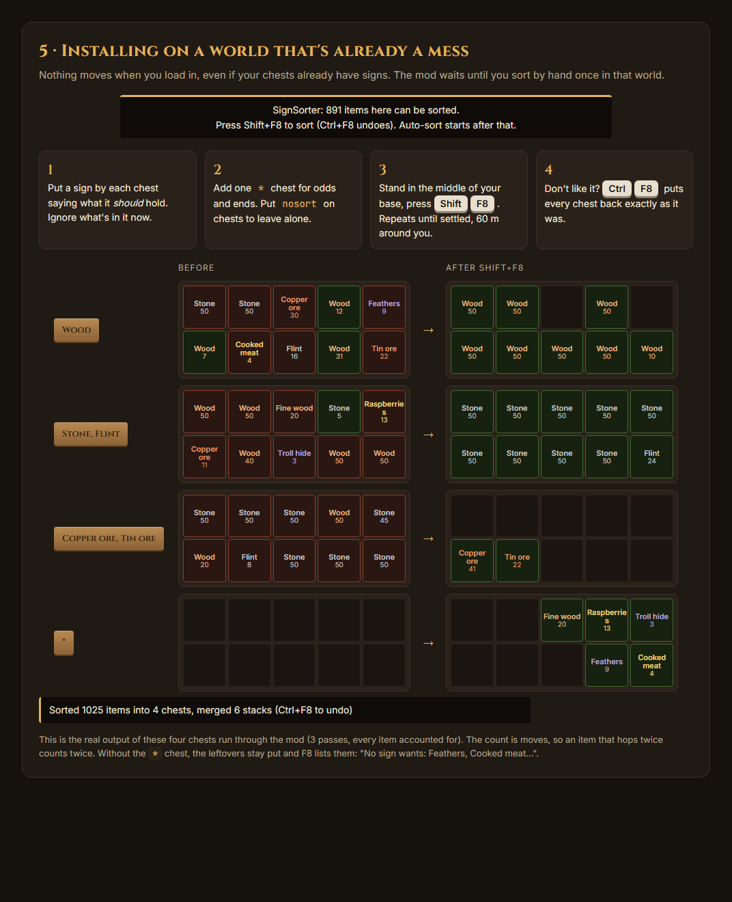

# SignSorter

A BepInEx mod for Valheim. Put a sign next to a chest, write what belongs in it, and items in nearby chests move there automatically.

Illustrated examples: [`docs/guide.html`](../docs/guide.html) (screenshots in [`docs/screenshots/`](../docs/screenshots/)).



## Signs

- A plain sign labels **the one chest closest to it** (within 2.5 m). An **arrow sign** labels the chest it points at (up to 4 m).
- Separate entries with commas (or `&`, `/`, `+`): `Wood, Fine wood, Core wood`.
- An item only moves to a chest whose sign wants it **more** than the one it's in now, so things never bounce back and forth.

| Sign says | Takes | Priority |
|---|---|---|
| `Fine wood` | That item. Any case/spacing, plurals OK (`Stones`, `Raspberry`). Also the internal prefab name (`FineWood`). | highest |
| `Fine wod` | A misspelling matches the *one* item it's closest to. Never when the entry is already a real item name ("Boar meat" won't grab Bear meat), never when two items are equally close. (`TypoTolerance`) | high |
| `*wood` | Wildcard. Spaces are ignored, so `*ore` also hits "Surtling core"; prefer the `Ores` category. | medium |
| `Food` `Meads` `Weapons` `Armor` `Shields` `Ammo` `Arrows` `Bolts` `Tools` `Trophies` `Fish` `Materials` `Ores` `Trinkets` `Misc` `Unteleportable` | Category | low |
| `*` | Leftovers from other labeled chests (overflow chest) | lowest |
| `nosort` | Never touch this chest | n/a |

**Chests without a sign** are inboxes: an item gets taken out only if some sign *names* it (exact, typo or wildcard). They never feed `*` or category chests, swaps never push things into them, and unsigned **personal** chests are never touched.

**Signs that name no item** ("Bob's house", "Don't touch") leave their chest alone.

### Arrows

When chests are side by side, point at the one you mean: `< Wood`, `Wood >`, `^ Wood` (chest above), `v Wood` (chest below). `<-` and `->` work too. Left and right are as you see them while reading the sign. If they come out swapped, turn on `FlipLeftRight`.



### Aliases (your own names)

`BepInEx/config/SignSorter.aliases.txt` is created on first launch with examples. It reloads automatically when you save it.

```
Metal, Bars = Copper, Tin, Bronze, Iron, Silver, Black metal, Flametal
Hides = *hide, *pelt, Leather scraps
Smithing = Metal, Ores, Coal          # aliases can use other aliases
```

Press **F8** and the mod tells you about any sign entry that doesn't match a real item.

## Installing on an existing (messy) world

**Nothing moves when you load in**, even if your chests already have signs. Automatic sorting only starts in a world after you sort it by hand once. Until then you get a one-time hint ("891 items here can be sorted. Press Shift+F8…").

1. Put a sign by each chest saying what it *should* hold.
2. Add one `*` chest for odds and ends; put `nosort` on chests to leave alone.
3. Stand in the middle of your base and press **Shift+F8** (deep sort: 60 m, repeats until settled). Full chests holding each other's items trade stacks; partial stacks merge.
4. Don't like the result? **Ctrl+F8** puts every chest back exactly as it was (using the game's own save format), as long as you haven't changed those chests since.



## Keys

| Key | Does |
|---|---|
| F8 | Sort chests within 20 m now; report unknown sign entries and items no sign wants |
| Shift+F8 | Deep sort (60 m, until nothing changes) |
| Ctrl+F8 | Undo the last F8 / Shift+F8 (all chests or none). Pauses auto-sort until you sort again |
| F9 | Put items from your bag into chests whose sign *names* them. Keeps equipped gear, a sheathed weapon, the hotbar row, and anything only a category or `*` chest would take (your food and arrows stay with you) |

Hotkeys work while you're running (holding W/A/S/D).

## Config

`BepInEx/config/local.signsorter.cfg` (r2modman: Config editor). Highlights:

- `AutoSortInterval` (5 s, 0 = hotkeys only), `AutoSortNeedsFirstManualSort` (on), `AutoSortOnlyMyChests` (off; for public servers), `ScanRadius` (20 m), `DeepSortRadius` (60 m)
- `SignRange` (2.5 m), `ArrowRange` (4 m), `FlipLeftRight`, `TypoTolerance`, `IgnoreTag`
- `SortFromUnlabeledChests` (on), `AllowSwaps` (on), `MergeStacks` (on)
- `ClaimChestOwnership` (off; see below), `VerboseLogging`

Worlds where auto-sort is switched on are listed in `BepInEx/config/SignSorter.worlds.txt`; delete a line to switch one off again.

## Multiplayer

A chest's contents only save if your game controls that chest on the network. In single player that's every chest; on a server it's usually every chest near you when nobody else is around. By default the mod skips chests another player's game controls (F8 tells you how many). `ClaimChestOwnership` lets hotkey sorts take control of them; it never takes a chest anyone has open. If you and a friend touch the same chest in the same moment, a change can be lost. Only you need the mod installed.

## Safety

- Every move goes through the game's own inventory code. After each move or swap, the mod re-counts both chests. If anything went wrong (for example another mod's save hook throwing an error), it puts the counts right, so items are never duplicated or lost.
- Chests anyone has open are never touched. The Obliterator, ships, carts and tombstones are never treated as chests.
- Auto-sort skips all work when no chest or sign has changed, so a sorted base costs almost nothing every 5 seconds.

### Tests

`SignSorter.Tests` runs the sorting logic against the game's real `Inventory` class (78 tests), including:

- 3,000 randomized messy bases: every item accounted for, no two items in one slot, a second sort finds nothing to do.
- 1,500 bases where save hooks randomly throw: still nothing lost or duplicated.
- Checks against all 1,071 real Valheim item names: no real name typo-matches a different item, and the default aliases only name real items.

## Building

```
dotnet build SignSorter -c Release
dotnet build SignSorter.Tests -c Release
dotnet SignSorter.Tests/bin/Release/SignSorter.Tests.dll          # run tests
dotnet SignSorter.Tests/bin/Release/SignSorter.Tests.dll --demo   # the messy-world example
```

Paths to Valheim and BepInEx are at the top of each `.csproj` (`ValheimDir`, `BepInExDir`); override with `-p:ValheimDir=...`. Copy only `SignSorter/bin/Release/SignSorter.dll` into `BepInEx/plugins/`.

## Not verified yet

Everything above was built and tested outside the game. In-game things that tests can't cover:

- Which way left/right arrows resolve on the real sign model (`FlipLeftRight` exists in case it's mirrored).
- The on-screen messages and hint.
- Multiplayer ownership behavior on a real server.
