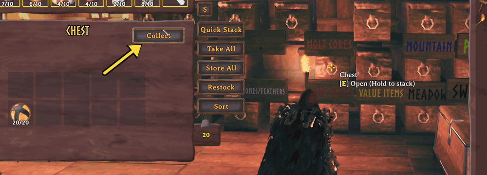

# CollectAll

Open a chest and Alt+click an item, or click Collect and then the item. Every stack of that item in the chests around you gets pulled into the one you have open.

## How to use

1. Open the chest you want to fill.
2. Click **Collect** in the top right of the chest panel. It switches to **Pick item...**
3. Click an item in the chest or in your inventory.

It grabs that item from every chest within 60 m, any quality, and tops up existing stacks before using empty slots. Your own inventory is never touched.

Alt + click an item in the chest to skip the button. Right-click or Esc cancels.

A message in the middle of the screen tells you what it did, like `Collected 120 Fine wood from 3 chests`.

## Keeping your stashes intact

By default it won't take from a chest that's completely full of just that item. So if you have a chest packed with wood, collecting wood somewhere else leaves it alone.

If you turn on `SkipBiggerPiles`, it also skips any chest that has more of the item than the one you're collecting into. Items only ever move toward your biggest pile.

## Chests it won't take from

- Chests someone has open
- The Obliterator, carts, ships and tombstones
- Private chests that aren't yours, and chests inside a ward you're not on
- In multiplayer, chests another player's game is in charge of

## Install

Use r2modman or Thunderstore Mod Manager. It installs BepInExPack_Valheim for you.

To install by hand, set up [BepInExPack_Valheim](https://thunderstore.io/c/valheim/p/denikson/BepInExPack_Valheim/) and drop `CollectAll.dll` into `BepInEx/plugins`.

## Config

Settings are in `BepInEx/config/dcarrigg.collectall.cfg`, or the config editor in your mod manager.

| Setting | Default | What it does |
|---|---|---|
| `Radius` | 60 | How far to look, in meters (2 to 100). The game only keeps about 64 m around you loaded |
| `AltClickShortcut` | true | Alt + click collects in one step |
| `SkipFullChests` | true | Leave chests full of only that item alone. Turn off to move a whole stash |
| `SkipBiggerPiles` | false | Leave chests that have more of the item alone |
| `Button.Text` | Collect | Button label |
| `Button.OffsetX` / `Button.OffsetY` | 0 | Move the button if another mod's button is in the way |

## Compatibility

Client side only. Nothing goes on the server and other players don't need it. Works in single player and multiplayer.

The button sits in the corner of the chest panel, so it doesn't fight with other chest mods like QuickStackStore.

## How it moves items

It uses the game's own inventory code. After each move it recounts both chests and fixes any difference, so nothing gets duplicated or lost.

## Bugs and ideas

Open an issue on [GitHub](https://github.com/d-carrigg/ValheimMods/issues).
