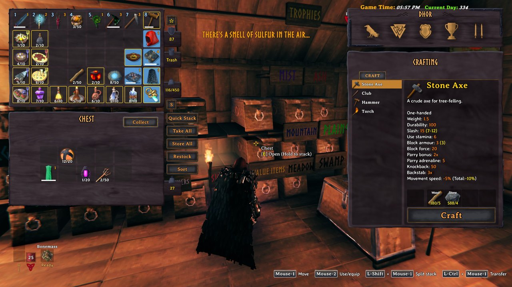
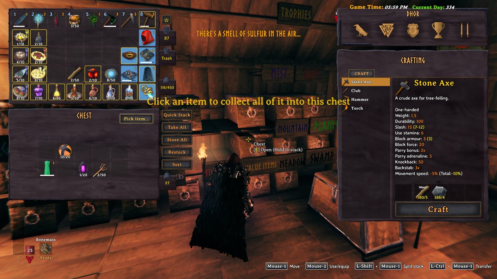

# CollectAll

Open a chest, click **Collect**, then click an item. Every other stack of that item in nearby chests moves into the chest you have open.

## How to use

1. Open the chest you want to fill.
2. Click **Collect** (top-right of the chest panel). It changes to **Pick item...**
3. Click an item, in the chest or in your inventory.

All other stacks of that item (any quality) in chests within 60 m move into this chest. Existing stacks are topped up before new slots are used.

- **Shortcut:** Alt + click an item in the chest to collect it in one step.
- **Cancel:** right-click or Esc.
- Your own inventory is never emptied, only other chests.
- A message in the middle of the screen says what happened, e.g. `Collected 120 Fine wood from 3 chests`.

## Screenshots

Click the item you want gathered:

Every stack of it from nearby chests is now in this one:

## Protecting your stashes

- **Full stashes are left alone** (on by default): a chest that is completely full of only that item is never taken from, so collecting elsewhere can't drain a finished stash.
- **Bigger pile wins** (off by default): a chest holding *more* of the item than yours is left alone, so items only flow toward your biggest pile.

## What it skips

- Chests someone has open
- The Obliterator, carts, ships and tombstones
- Chests you can't access (private chests, chests in a ward you aren't on)
- In multiplayer, chests another player's game currently controls (see `ClaimChestOwnership`)

## Installation

- **Mod manager (recommended):** install with r2modman or Thunderstore Mod Manager. BepInExPack_Valheim is installed for you.
- **Manual:** install [BepInExPack_Valheim](https://thunderstore.io/c/valheim/p/denikson/BepInExPack_Valheim/), then copy `CollectAll.dll` into `BepInEx/plugins`.

## Configuration

Edit `BepInEx/config/dcarrigg.collectall.cfg`, or use your mod manager's config editor.

| Setting | Default | What it does |
|---|---|---|
| `Radius` | 60 | Search distance in meters (2 to 100). The game only keeps about 64 m around you loaded |
| `AltClickShortcut` | true | Alt + click collects in one step |
| `SkipFullChests` | true | Leave full, single-item chests alone. Turn off to move a whole stash |
| `SkipBiggerPiles` | false | Leave chests that hold more of the item alone |
| `ClaimChestOwnership` | false | Multiplayer: also take from chests another player's game controls. Can duplicate or lose items under lag |
| `Button.Text` | Collect | Button label |
| `Button.OffsetX` / `Button.OffsetY` | 0 | Move the button if another mod's button overlaps it |

## Compatibility

- Client-side only. Nothing is needed on the server, and other players don't need it.
- Works in single player and multiplayer.
- The button is pinned to the chest panel's corner, so it sits alongside other chest mods such as QuickStackStore.

## Safety

Every move uses the game's own inventory code, and both chests are re-counted afterwards so items are never duplicated or lost (except the lag risk noted for `ClaimChestOwnership`).

## Feedback

Bugs and suggestions: [GitHub issues](https://github.com/d-carrigg/ValheimMods/issues)
